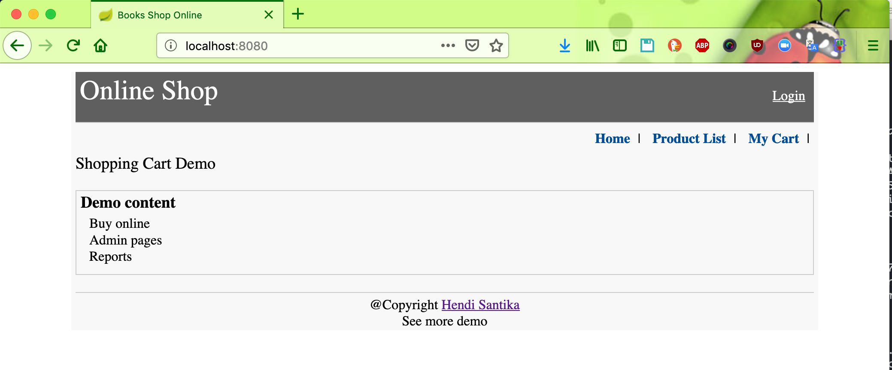
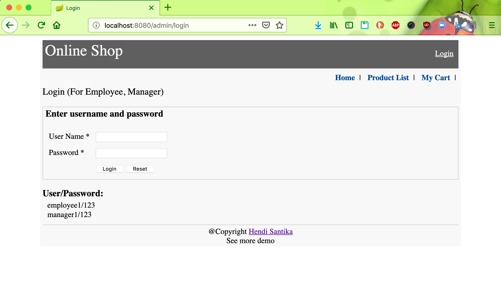
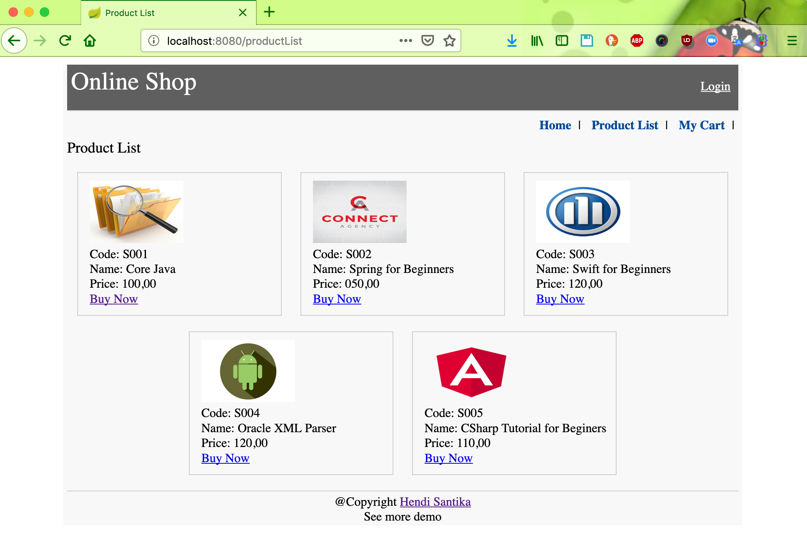
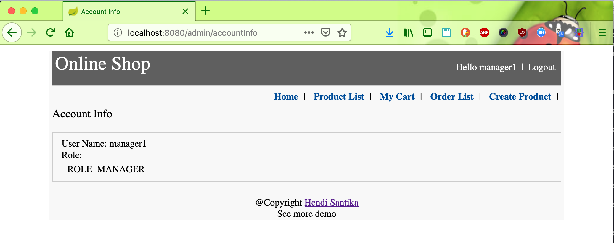
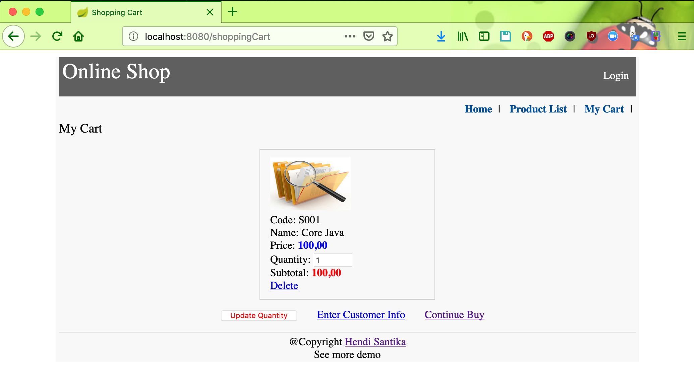

# shopping-chart

[](https://github.com/hendisantika/shopping-chart/actions/workflows/maven.yml)


[](.github/dependabot.yml)

Simple online shopping cart web application built with Spring Boot, Hibernate, Spring Security and Thymeleaf.

## Tech Stack

| Component        | Version / Library                                              |
|------------------|----------------------------------------------------------------|
| Java             | **JDK 25** (Temurin recommended)                               |
| Framework        | Spring Boot 4.1 (Spring Framework 7, Spring Security 7)        |
| Persistence      | Hibernate 7 (`SessionFactory`), Flyway database migrations     |
| View             | Thymeleaf + `thymeleaf-extras-springsecurity6`                 |
| Database         | MySQL 8 (drivers for PostgreSQL, SQL Server and Oracle bundled) |
| Testing          | JUnit 5, Testcontainers 2 (MySQL 8.4)                          |
| Build            | Maven 3.9+ (Maven Wrapper included)                            |

## Prerequisites

- JDK 25
- Maven 3.9+ (or use the bundled `./mvnw`)
- MySQL 8 running on `localhost:3306` (user `root` / password `root`, see `src/main/resources/application.properties`)
- Docker (only required to run the tests, Testcontainers starts MySQL automatically)

## Things to do

1. Clone repository: `git clone https://github.com/hendisantika/shopping-chart.git`
2. Go to the folder: `cd shopping-chart`
3. Make sure MySQL is running. The `shoppingCart` database is created automatically and
   tables + sample data are created by Flyway (`src/main/resources/db/migration`).
4. Run the app: `mvn clean spring-boot:run`
5. Open your favorite browser: http://localhost:8080

### Run the tests

```shell
mvn clean verify
```

Tests use Testcontainers (`jdbc:tc:mysql:8.4.0`), so Docker must be running.

### Build an executable jar

```shell
mvn clean package
java -jar target/shopping-chart-0.0.1-SNAPSHOT.jar
```

## Default Accounts

Sample accounts are inserted by `V2__27042019_Init_Data.sql`:

| Username   | Password | Role     |
|------------|----------|----------|
| `employee1` | `123`    | EMPLOYEE |
| `manager1`  | `123`    | MANAGER  |

## CI/CD & Dependency Management

- **GitHub Actions** (`.github/workflows/maven.yml`): builds and tests the project with JDK 25 on every push and
  pull request to `master`, then submits the Maven dependency graph so Dependabot alerts stay accurate.
- **Dependabot** (`.github/dependabot.yml`): weekly (Monday 05:00 WIB) updates for Maven dependencies and GitHub
  Actions, grouped into Spring Boot, Testcontainers, JDBC drivers, Apache Commons, Maven minor/patch and GitHub Actions
  PRs. Major Spring Boot upgrades are ignored because they need a manual migration.

## Screen shot

Home Page



Login Page



Product List Page



Account Info Page



Shopping Cart Page


